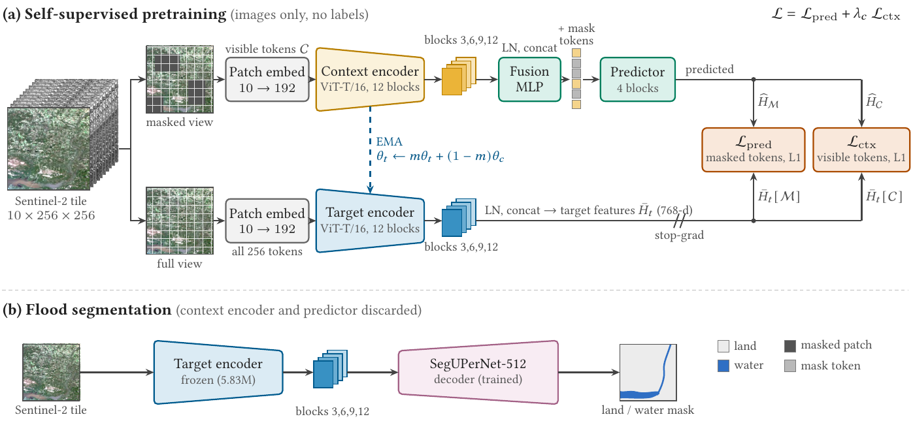

# Flood-JEPA

Flood-JEPA learns flood-extent mapping from Sentinel-2 without reconstructing pixels. It is inspired by [V-JEPA 2.1](https://arxiv.org/abs/2603.14482): a context encoder sees a masked view, an exponential-moving-average target encoder sees the full view, and a small predictor matches the target's latent tokens. The target is stop-gradient. Nothing in pretraining is a label.

What Flood-JEPA adds is the flood setting. The stem takes ten Sentinel-2 bands. The loss supervises four encoder depths, not only the last block, and it predicts the visible tokens as well as the masked ones. After pretraining, the context encoder and the predictor are discarded. The frozen target encoder, 5.83M parameters, feeds a SegUPerNet-512 decoder that is trained to draw the land and water mask.

The recipe in this repository is the single-GPU WorldFloods v2 run: ViT-Tiny/16 pretraining for 100 epochs, then frozen SegUPerNet-512 fine-tuning for 30 epochs. The checkpoint with the highest validation mean intersection-over-union is scored once on the held-out test tiles.

<p align="center">
  
</p>

<p align="center">
  <a href="flood-jepa-arch.pdf">Open the architecture figure as a PDF</a>
</p>

## From V-JEPA 2.1 to flood mapping

V-JEPA 2.1 predicts in representation space. A video or image is split into tokens. Some tokens are hidden from the context encoder. The predictor, conditioned on the visible tokens and on learned mask tokens, has to match the target encoder's embedding of the hidden tokens. The target encoder is an exponential moving average of the context encoder, so the prediction target moves slowly and does not collapse into a trivial constant.

Flood-JEPA keeps that skeleton and changes the signal it is asked to understand.

| V-JEPA 2.1 idea | What Flood-JEPA does with it |
| --- | --- |
| Latent prediction, not pixel reconstruction | L1 loss between predicted tokens and stop-gradient target tokens |
| Context encoder on the masked view | ViT-Tiny/16, 12 blocks, width 192, patch size 16 |
| EMA target encoder on the full view | Same ViT-Tiny, updated by `θ_t ← m θ_t + (1 − m) θ_c` with `m = 0.99925` |
| Predictor conditioned on mask tokens | 4 blocks, width 192, 6 heads, 2.26M parameters |
| One final representation | Targets taken from blocks 3, 6, 9, and 12, layer-normalized and concatenated to 768 dimensions |
| Downstream probe | Context encoder and predictor are thrown away. SegUPerNet-512 reads the frozen target encoder |

The encoder and predictor blocks are the V-JEPA 2.1 ViT, vendored under `third_party/vjepa2` from [facebookresearch/vjepa2](https://github.com/facebookresearch/vjepa2). Flood-JEPA adds the ten-band patch embed (`10 → 192`), the deep-target fusion MLP, the visible-token loss, the WorldFloods masking schedule, and the segmentation head.

## How a training step works

Panel (a) of the figure is pretraining. Labels are not used.

1. A Sentinel-2 tile, `10 × 256 × 256`, is shown twice. The full view goes to the target encoder and keeps all 256 tokens. The masked view goes to the context encoder and hides a set of tokens `M`, leaving the visible set `C`.
2. Both encoders are ViT-Tiny/16. Features are read at blocks 3, 6, 9, and 12, layer-normalized, and concatenated. The target side is the 768-dimensional tensor `H̄_t`. Gradients do not flow through it.
3. On the context side, a fusion MLP mixes the four depths. Learned mask tokens are inserted at the hidden positions. The 4-block predictor emits `Ĥ_M` for the masked locations and `Ĥ_C` for the visible ones.
4. The loss is `L = L_pred + λ_c L_ctx`. `L_pred` is the L1 error on masked tokens. `L_ctx` is the L1 error on visible tokens. `λ_c` is 0.5, and it stays at zero until 5% of training, then rises linearly and reaches 0.5 at 10% of training.

Panel (b) is flood segmentation. The context encoder and the predictor are discarded. A new Sentinel-2 tile goes only through the frozen target encoder. Blocks 3, 6, 9, and 12 go into SegUPerNet-512, which is the only module trained in this stage. Its output is a land and water mask. Pixels that are cloudy, invalid, or padding stay ignore index 255 and do not enter the loss.

## Model card

| Piece | Setting |
| --- | --- |
| Encoder | ViT-Tiny/16, 5.83M parameters, 12 blocks, width 192, patch 16 |
| Patch embed | Linear map from 10 bands to 192 |
| Predictor | 4 blocks, width 192, 6 heads, 2.26M parameters |
| Target features | Blocks 3, 6, 9, 12, concatenated to 768 dimensions |
| Objective | `L_pred + λ_c L_ctx`, both L1 |
| Visible-token weight | 0.5 after a warm-up from 5% to 10% of training |
| EMA momentum | 0.99925 |
| Bands | B2, B3, B4, B5, B6, B7, B8, B8A, B11, B12 |
| Pretraining | 256 crops from 512 tiles, global batch 32, 100 epochs, AdamW 2e-4, 10-epoch warm-up, BF16 |
| Downstream | Frozen target encoder, SegUPerNet-512, global batch 14, 30 epochs, decoder learning rate 2e-5 |
| Segmentation loss | Cross-entropy + Dice + 0.5 focal, class weights from the training split |
| Selection | Highest validation global mIoU, then one test evaluation |

## Ablations

A, B, and C change only the pretraining target. The encoder, the crop, the optimizer, and the downstream decoder stay the same. For the masked-only runs the visible-token weight is zero for the whole training run. One supervised depth uses the final block. Four depths use blocks 3, 6, 9, and 12. Each depth is layer-normalized before the loss is averaged, so four depths do not multiply the objective by four. The predictor's input projection is wider in the four-depth models, which is why the predictor is 2.26M parameters there and smaller when only the final block is supervised.

| ID | Masked tokens | Visible tokens | Supervised depths | Config |
| --- | --- | --- | --- | --- |
| A | yes | no | final block | `configs/pretrain_vitt16_256_10band_h100_A.yaml` |
| B | yes | yes | final block | `configs/pretrain_vitt16_256_10band_h100_B.yaml` |
| C | yes | no | blocks 3, 6, 9, 12 | `configs/pretrain_vitt16_256_10band_h100_C.yaml` |
| D | yes | yes | blocks 3, 6, 9, 12 | `configs/pretrain_vitt16_256_10band_h100.yaml` |

D is the full Flood-JEPA model drawn in the figure.

## Setup

Python 3.11 or newer. The numbers below were measured on one NVIDIA H100 with the CUDA 12.4 PyTorch wheel. A different GPU is fine if it can run BF16 and hold a ViT-Tiny plus SegUPerNet-512. The published batch sizes assume one GPU: 32 for pretraining and 14 for fine-tuning.

```bash
python3.12 -m venv .venv
source .venv/bin/activate
python -m pip install --upgrade pip
python -m pip install torch torchvision --index-url https://download.pytorch.org/whl/cu124
bash scripts/setup_environment.sh
```

`scripts/setup_environment.sh` installs the vendored V-JEPA package and this repository in editable mode. If that step replaces the CUDA build of PyTorch, install the CUDA wheel again with the command above.

```bash
python -c "import torch, flood_jepa; print(torch.__version__, torch.cuda.get_device_name(0))"
python -m pytest -q
```

## Data

Training reads packed 512 × 512 tiles, not the raw scene GeoTIFFs. The public WorldFloods v2 release is [`isp-uv-es/WorldFloodsv2`](https://huggingface.co/datasets/isp-uv-es/WorldFloodsv2), about 76 GB compressed and about 96 GB on disk.

```bash
pip install -U huggingface_hub
hf download isp-uv-es/WorldFloodsv2 --repo-type dataset \
  --local-dir datasets/WorldFloodsv2

python scripts/build_worldfloods_lmdb.py \
  --source-root datasets/WorldFloodsv2 \
  --output-dir datasets/WorldFloodsv2/lmdb
```

Scenes are read in sorted filename order and cut into non-overlapping 512 × 512 windows, including a padded border window. Image padding is 0. Label padding is 255. A window is kept only when it contains at least one clear land or clear water pixel. The builder checks the benchmark counts: 21,364 train, 751 validation, and 841 test tiles. The ten stored bands are the `sub_20` Sentinel-2 subset, and the normalization constants are the fixed training-split values. They are not refit.

```bash
export WORLDFLOODS_LMDB_DIR="$PWD/datasets/WorldFloodsv2/lmdb"
bash scripts/verify_worldfloods.sh
```

## Pretraining

One GPU, global batch 32, 100 epochs, seed 42 unless you set `SEED`. This is panel (a). It does not use flood labels.

```bash
export SEED=42
export WORLDFLOODS_LMDB_DIR="$PWD/datasets/WorldFloodsv2/lmdb"
bash scripts/run_vitt10_h100_pipeline.sh pretrain
```

Checkpoints land in `results/h100/vjepa21_vitt16_worldfloods_10band_256/pretrain/seed_42/checkpoints/`. Fine-tuning reads `epoch_100.pt`.

A five-step smoke run uses a separate output directory and does not overwrite a real run:

```bash
bash scripts/run_vitt10_h100_pipeline.sh smoke
```

To pretrain an ablation instead of D, point the launcher at that config and give it its own output directory:

```bash
export SEED=42
export PRETRAIN_CONFIG="$PWD/configs/pretrain_vitt16_256_10band_h100_A.yaml"
export PRETRAIN_OUTPUT="$PWD/results/h100/ablation/A/pretrain/seed_42"
bash scripts/run_vitt10_h100_pretrain.sh pretrain
```

Swap the filename for `_B.yaml` or `_C.yaml` to run the other two.

## Fine-tuning

This is panel (b). The EMA target encoder stays frozen. Only SegUPerNet-512 is trained, for 30 epochs at global batch 14, decoder learning rate `2e-5`, with a 3-epoch warm-up and a cosine schedule. The segmentation loss is cross-entropy plus Dice plus 0.5 focal. The checkpoint with the best validation global mIoU is saved as `best.pt`.

```bash
export SEED=42
export WORLDFLOODS_LMDB_DIR="$PWD/datasets/WorldFloodsv2/lmdb"
bash scripts/run_vitt10_h100_pipeline.sh finetune
```

Train and then evaluate that checkpoint once on the 841 test tiles:

```bash
bash scripts/run_vitt10_h100_pipeline.sh train-test
```

Pretrain and fine-tune back to back:

```bash
bash scripts/run_vitt10_h100_pipeline.sh all
```

Score a finished checkpoint without training again:

```bash
export SEED=42
export EVAL_SPLIT=test
bash scripts/evaluate_vitt10_h100.sh
```

`EVAL_SPLIT=val` repeats the validation number used to pick the checkpoint. `EVAL_SPLIT=test` is the held-out report. The test split is not used to choose the epoch, the seed, or the threshold.

## Results

WorldFloods v2 test set. Every system uses the same SegUPerNet-512 decoder width. Frozen means the encoder was pretrained and then held fixed. Sup. means the whole network was trained with flood labels. Encoder parameter counts leave out the decoder. The Flood-JEPA row is the best of seeds 42, 11, and 22 from this repository, which is seed 22. The other rows are the benchmark numbers for those models. They were not retrained here.

| Method | Enc. params (M) | Track | mIoU | Land IoU | Water IoU | Water precision | Water recall | Water F1 |
| --- | ---: | --- | ---: | ---: | ---: | ---: | ---: | ---: |
| OLMoEarth-B | ~114.00 | Frozen | 86.90 | 91.77 | 82.03 | 91.25 | 89.04 | 90.13 |
| U-Net | 9.41 | Sup. | 86.76 | 91.76 | 81.76 | 92.06 | 87.96 | 89.97 |
| DOFA ViT-B | 111.31 | Frozen | 86.11 | 91.37 | 80.86 | 91.85 | 87.10 | 89.41 |
| CROMA-L Optical | 303.03 | Frozen | 86.03 | 91.32 | 80.74 | 91.84 | 86.98 | 89.34 |
| TerraMind-L | ~305.66 | Frozen | 85.95 | 91.28 | 80.62 | 91.90 | 86.79 | 89.27 |
| Flood-JEPA ViT-T/16 | 5.83 | Frozen | 85.84 | 91.13 | 80.56 | 90.88 | 87.65 | 89.23 |
| Random ViT-B/16 | 87.17 | Sup. | 85.72 | 91.04 | 80.40 | 90.68 | 87.64 | 89.13 |
| DeepLabV3+ R50 | 23.53 | Sup. | 80.23 | 87.46 | 73.00 | 86.35 | 82.52 | 84.39 |
| GFM-Swin | 86.73 | Frozen | 69.39 | 80.61 | 58.16 | 78.46 | 69.22 | 73.55 |
| Scale-MAE ViT-L | 303.30 | Frozen | 68.33 | 80.06 | 56.60 | 78.09 | 67.29 | 72.29 |

Flood-JEPA is the smallest encoder in the table. This best run sits just below the larger frozen encoders and the supervised U-Net, and well above DeepLabV3+, GFM-Swin, and Scale-MAE.

## Layout

```text
assets/flood-jepa-arch.png     architecture figure used above
flood-jepa-arch.pdf            same figure, vector PDF
configs/                       pretraining and fine-tuning recipes, including A, B, and C
scripts/                       setup, LMDB packing, train, and evaluate
src/flood_jepa/                stem, loss, data, and the segmentation loop
tests/                         checks for the configs, the model, and the LMDB reader
third_party/vjepa2/            V-JEPA 2.1 encoder and predictor modules used here
```

Datasets, LMDB files, and checkpoints are not in this repository. Put the packed tiles in `datasets/WorldFloodsv2/lmdb/`, or point `WORLDFLOODS_LMDB_DIR` somewhere else.

## License

The Flood-JEPA training code is released with this repository. The vendored V-JEPA 2.1 files under `third_party/vjepa2` stay under the MIT license in `third_party/vjepa2/LICENSE`.
